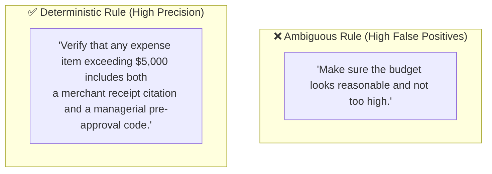

# Operational Rule Profiles & Configuration Manual: The Mary Engine
## Production Rule Catalog, Severity Triggers & Compliance Checklists
**Document Version:** 3.1.0  
**Document Status:** Approved Reference Manual  
**Classification:** Operational Guide  
**Target Audience:** Department Leads, Quality Managers, Operations Directors, System Administrators  

---

## 1. Overview & Operational Philosophy

The Mary Engine evaluates incoming documents against **Rule Profiles** configured by department leads. 

In traditional enterprise software, altering review criteria requires software engineering tickets, regex authoring, and server redeployments. In The Mary Engine, leads configure review standards via a **No-Code Hybrid Rule Builder** combining:
1. **Mandatory Sections Checklist:** Binary structural requirements (e.g. Executive Summary, Risk Matrix, Budget Table).
2. **Quantitative Threshold Alarms:** Mathematical boundaries on metrics (e.g. Budget variance > 10%, timeline slippage > 7 days).
3. **Red-Flag Keyword Tripwires:** Specific vocabulary triggers that require supervisory escalation (e.g. *litigation, structural crack, unauthorized spend*).
4. **Natural-Language Custom Rule Cards:** Plain-English guidelines evaluated by the LLM (e.g. *"Ensure any mention of concrete pouring references a 28-day curing strength certificate"*).

---

## 2. Rule Profile Catalog (Production Ready)

### Template A: Project Management Office (PMO) Progress Review
* **Target Roles:** Project Managers, Lead Engineers, Subcontractor Coordinators
* **Ingested Documents:** Weekly Progress Reports, Milestone Deliverables, Change Requests
* **Default Severity:** Strict (`CRITICAL` thresholds block approval)

#### 1. Mandatory Sections (Must Be Present in Report)
| Section Name | Required Contents | Failure Severity |
| :--- | :--- | :---: |
| **Executive Summary** | High-level status overview (150–250 words) | `CRITICAL` |
| **Milestone Schedule Table** | Target completion date vs. actual completion date | `CRITICAL` |
| **Budget & Expenditure Log** | Current period spend, variance against forecasted budget | `CRITICAL` |
| **Risks & Blockers Register** | At least one operational risk identified with mitigation plan | `WARNING` |
| **Next Period Deliverables** | Minimum 3 concrete deliverable commitments for the upcoming week | `WARNING` |

#### 2. Quantitative Threshold Alarms
* **Budget Variance Alarm:** Flag any expenditure line item where actual spend exceeds forecast by \(\ge 10\%\).
  * *Severity:* `CRITICAL`
  * *Remediation Prompt:* *"Budget overrun detected without attached formal Change Order sign-off."*
* **Milestone Slippage Alarm:** Flag any milestone where completion date has slipped by \(\ge 7\) days without an updated critical path schedule.
  * *Severity:* `WARNING`
  * *Remediation Prompt:* *"Schedule slippage requires an updated timeline and revised milestone date."*

#### 3. Red-Flag Keyword Tripwires
The engine scans the entire report and extracts the surrounding paragraph for the following terms:
* `litigation`, `lawsuit`, `dispute`, `breach of contract` (Severity: `CRITICAL`)
* `unapproved change`, `out of scope`, `unauthorized work` (Severity: `CRITICAL`)
* `cash flow deficit`, `insolvency`, `payment freeze` (Severity: `CRITICAL`)
* `equipment breakdown`, `crane failure`, `generator outage` (Severity: `WARNING`)
* `awaiting client approval`, `permit pending` (Severity: `INFO`)

#### 4. Custom Rule Cards (Natural Language)
* **Card 1 (Subcontractor Verification):** *"Verify that every subcontractor mentioned on-site has a corresponding safety induction clearance date recorded in the personnel log."*
* **Card 2 (Weather Delay Substantiation):** *"If weather delays (e.g. heavy rainfall) are cited as the cause of milestone slippage, ensure specific rainfall measurements or meteorological station reports are cited."*

---

### Template B: Field Mission & Humanitarian Operations Log
* **Target Roles:** Field Officers, Camp Coordinators, Monitoring & Evaluation (M&E) Specialists
* **Ingested Documents:** Mission Reports, Relief Distribution Tallies, Assessment Sheets
* **Default Severity:** Human-Centric (`CRITICAL` on safety and aid distribution)

#### 1. Mandatory Sections
| Section Name | Required Contents | Failure Severity |
| :--- | :--- | :---: |
| **Mission Objective & Dates** | Geographic location, dates in field, team composition | `CRITICAL` |
| **Beneficiary Disaggregation** | Distribution totals disaggregated by gender and age group | `CRITICAL` |
| **Supply Chain & Stock Balance** | Received quantity, distributed quantity, remaining stock balance | `CRITICAL` |
| **Security & Access Incidents** | Any security checkpoints, roadblocks, or access denials | `CRITICAL` |
| **Community Feedback & Complaints**| Direct community quotes, complaints, or feedback recorded | `WARNING` |

#### 2. Quantitative Threshold Alarms
* **Distribution Variance Alarm:** Flag if distributed aid does not balance against stock received minus remaining inventory (\(\Delta \ne 0\)).
  * *Severity:* `CRITICAL`
  * *Remediation Prompt:* *"Distribution inventory numbers do not balance mathematically against opening stock."*

#### 3. Red-Flag Keyword Tripwires
* `security incident`, `armed robbery`, `ambush`, `curfew` (Severity: `CRITICAL`)
* `aid diversion`, `extortion`, `missing supplies` (Severity: `CRITICAL`)
* `disease outbreak`, `cholera`, `malnutrition spike` (Severity: `CRITICAL`)
* `road impassable`, `bridge collapsed` (Severity: `WARNING`)

#### 4. Custom Rule Cards (Natural Language)
* **Card 1 (Informed Consent):** *"Ensure that any beneficiary case studies or photographs cited state that verbal or written informed consent was obtained."*
* **Card 2 (Data Protection):** *"Flag any mention of individual beneficiary full names or national identity card numbers in the public narrative to protect privacy."*

---

### Template C: Consulting / Client Assessment Quality Audit
* **Target Roles:** Engagement Managers, Senior Consultants, Research Associates
* **Ingested Documents:** Client Assessment Reports, Strategic Briefs, Due Diligence Memos
* **Default Severity:** Rigorous (`CRITICAL` on ungrounded claims and tone)

#### 1. Mandatory Sections
| Section Name | Required Contents | Failure Severity |
| :--- | :--- | :---: |
| **Executive Summary** | Standalone synthesis of strategic recommendations (max 2 pages) | `CRITICAL` |
| **Methodology & Data Sources**| Primary research sample size, secondary literature cited | `CRITICAL` |
| **Findings & Analysis** | Core empirical findings organized by thematic workstream | `CRITICAL` |
| **Actionable Recommendations**| Prioritized roadmap with implementation owners and timeframes | `CRITICAL` |

#### 2. Style & Quality Inspection Rules
* **Vague / Passive Language Alarm:** Flag sentences utilizing unbacked assertions such as *"stakeholders widely believe"*, *"significant improvements were noted"*, or *"industry standards recommend"* without citing specific survey data, interview counts, or benchmark reports.
  * *Severity:* `WARNING`
  * *Remediation Prompt:* *"Assertive claim lacks supporting empirical evidence or data source citation."*

#### 3. Red-Flag Keyword Tripwires
* `we guarantee`, `zero risk`, `guaranteed return` (Severity: `CRITICAL` — Regulatory liability)
* `confidential draft`, `do not distribute` (Severity: `WARNING` — Verify distribution permissions)
* `unverified estimate`, `preliminary guess` (Severity: `WARNING`)

#### 4. Custom Rule Cards (Natural Language)
* **Card 1 (Financial Model Reconciliation):** *"Ensure that all market size projections cited in the narrative match the exact figures in the attached valuation model summary table."*
* **Card 2 (Competitor Neutrality):** *"Ensure that discussions of client competitors use objective, factual descriptions without disparaging or defamatory commentary."*

---

## 3. Authoring Custom Rule Cards: Best Practice Guide

When Mary adds a **Custom Rule Card** in natural language, the engine dynamically injects it into the LLM evaluation envelope. Follow these authoring standards for maximum accuracy:

### Golden Rules for Rule Card Authoring:
1. **Be Binary and Verifiable:** State explicitly what evidence must exist in the text.
   - *Bad:* *"Ensure good progress was achieved."*
   - *Good:* *"Verify that the actual completion percentage is stated for each listed milestone."*
2. **Specify Exceptions:** Tell the agent when the rule does not apply.
   - *Example:* *"Flag any missing safety permit, unless the report explicitly states that site activities were restricted to remote desktop design."*
3. **Include Remediation Guidance:** Tell the submitter how to fix it.
   - *Example:* *"Remediation: Provide the environmental clearance certificate number issued by the county authorities."*

> [!NOTE]
> **Rule Profile Versioning:** Rule profiles are version-controlled. When a profile is edited, the previous version is automatically archived. Past scorecards always reference the exact version they were evaluated against. Mary can use the **Re-evaluate** button to re-score past reports against updated rules.
