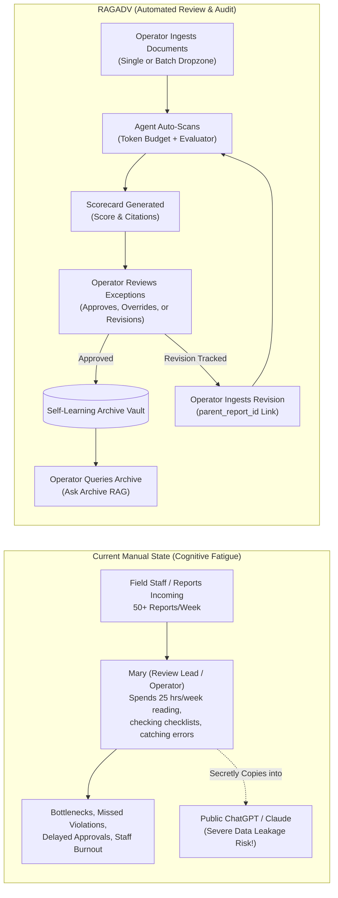
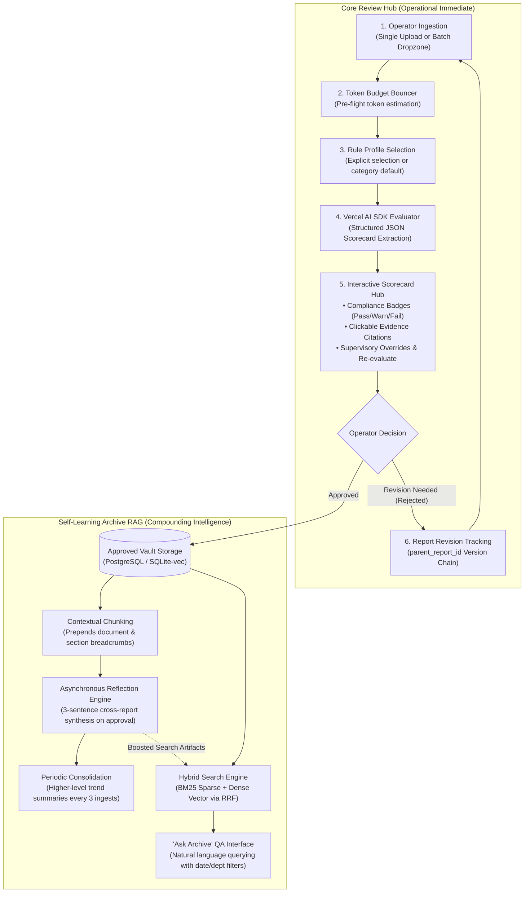

# Product & Functional Specification: RAGADV
## Automated Enterprise Document Review, Compliance Auditing & Self-Learning Knowledge Platform
**Document Version:** 3.5.0  
**Document Status:** Approved for Engineering Scaffolding  
**Classification:** Internal Technical Architecture  
**Target Audience:** Engineering Leads, Product Managers, Security Officers, Operations Directors  

---

## 1. Executive Summary & Problem Space

In knowledge-intensive and operationally complex organizations, team leads, project managers, and quality directors face an acute, systemic operational crisis: **the human cognitive bottleneck of reviewing repetitive, high-volume internal reports**.



### 1.1 The Archetypal Persona: "Mary", The Review Bottleneck
- **Role:** Department Lead, Senior Project Manager, Quality Assurance Director, or Desk Editor operating as the sole system Operator.
- **Direct Reports / Operational Volume:** Receives 20 to 100 multi-page documents per week (weekly progress logs, site inspection checklists, grant monitoring tallies, consulting drafts, audit filings) from project teams and field operations.
- **Incoming Volume:** 20 to 100 multi-page documents per week (weekly progress logs, site inspection checklists, grant monitoring tallies, consulting drafts, audit filings).
- **Core Friction:** 
  1. **High Redundancy, Low Cognitive Reward:** 85% of each report consists of routine, predictable status narrative. However, Mary cannot skim blindly because critical non-compliance (unauthorized budget changes, missing safety sign-offs, delayed milestones, or legal liabilities) is frequently buried within paragraphs.
  2. **Review Fatigue & Human Error:** After reading the eighth 12-page report on a Friday afternoon, cognitive acuity plummets. Subtle schedule slips and unmitigated risks slip through unnoticed.
  3. **Feedback Drafting Overhead:** When a report fails compliance, Mary must spend an additional 20 minutes drafting an email explaining what was omitted, quoting lines, and requesting revisions.

### 1.2 The Systemic Hazard: Uncontrolled Public LLM Leakage
Faced with overwhelming document volumes, operational staff and managers increasingly resort to pasting proprietary internal documents into consumer AI chatboxes (ChatGPT, Claude, Copilot web). This introduces catastrophic data exposure:
- Inadvertent leak of non-public financial budgets, subcontractor rates, and margin data.
- Exposure of personally identifiable information (PII) of beneficiaries, field agents, or patients.
- Breach of client non-disclosure agreements (NDAs) and statutory data privacy frameworks (e.g., GDPR, Kenya Data Protection Act 2019).

### 1.3 The Solution Vision: An Enterprise ATS for Reports
RAGADV is a **named commercial product** intended for sale to multiple organizations (not a single-client custom build). Each customer organization receives their own isolated deployment. A public landing page will communicate the value proposition. This platform adopts the battle-tested architectural paradigm of **Applicant Tracking Systems (ATS)**—which screen thousands of candidate CVs against explicit, structured vacancy requirements—and transposes it to **Enterprise Document and Report Governance**:
1. **Direct Ingestion & Review Platform:** The Operator uploads documents directly into the workspace (via single-document upload or batch dropzone). The system automatically evaluates each document against the selected or category-default rule profile.
2. **Explicit Rule Profiles:** Reports are audited against concrete, version-controlled **Rule Profiles** defining mandatory sections, numerical threshold alarms, and red-flag linguistic tripwires.
3. **No-Code Hybrid Configuration:** The Operator configures and extends inspection rules via intuitive form toggles, slider limits, and natural-language "Custom Rule Cards"—no coding, regex, or Python required.
4. **Deterministic Scorecards & 1-Click Feedback:** The engine generates strongly-typed, verifiable review scorecards with verbatim citations down to page numbers, paired with supervisory overrides, re-evaluation triggers, and an automated feedback memo generator.
5. **Self-Learning Knowledge Archive:** Approved reports automatically populate an enterprise knowledge vault powered by **Anthropic-style Contextual Retrieval**, **Hybrid BM25 + Vector Search (with Reciprocal Rank Fusion)**, and an **Asynchronous Knowledge Reflection Engine** that synthesizes multi-document organizational trends over time.

---

## 2. Core User Persona & Access Model

**Single-Person Sign-In (Env-Configured):** The application is protected by a single-person login screen. Authentication is verified directly against an environment variable password (`ADMIN_PASSWORD`). There is no user registration, no password reset flow, and no multi-user session management. Upon entering the correct administrative password, a secure session is established and maintained via an encrypted HTTP-only cookie. Inactive sessions expire after 24 hours. Single Sign-On (SSO) and external identity providers are not used.

**Zero RBAC / Roles:** The platform implements zero role-based access control (RBAC). The legacy 3-role hierarchy (Admin, Reviewer, Member) and associated user-role tables are completely removed. The logged-in user is the sole **Operator** with complete system access across all views, data collections, and administrative functions.

**The Operator Persona & Capabilities:**
The Operator (modeled after lead reviewer Mary) manages the entire document compliance and knowledge lifecycle through a unified dashboard interface:
- **Rule Profile Management:** Creates, versions, modifies, and assigns Rule Profiles across organizational categories; sets default profiles.
- **Document Ingestion:** Uploads documents directly via single-file upload or batch dropzone (5–25 documents per batch).
- **Automated AI Scorecards:** Reviews AI-generated compliance scorecards with deterministic scoring, rule violation breakdowns, and verbatim text citations.
- **Supervisory Overrides & Actions:** Resolves false-positive flags with audit comments, triggers instant re-evaluations against active rule profiles without re-uploading, approves documents for knowledge archive ingestion, or rejects/requests revisions.
- **Revision & Version Tracking:** Ingests document revisions and tracks revision lineage via parent-child links (`parent_report_id`).
- **Archive Querying:** Queries the institutional repository using natural language via the "Ask Archive" Hybrid RAG interface.

**Organizational Categories & Departments:** Categories and departments exist strictly as organizational tags and folders with assigned default rule profiles for structured document filing and search filtering. There is zero user-isolation or cross-tenant filtering logic, and the Operator maintains unrestricted global visibility across all categories.

---

## 3. Product Architecture



### 3.1 Report Lifecycle
The platform enforces a two-track lifecycle for submitted reports:
- **Approved Reports:** Permanently stored in Cloudflare R2. Automatically ingested into the RAG archive (chunked, embedded, reflected) the moment the Operator clicks Approve. These form the organization's institutional knowledge.
- **Failed/Rejected Reports:** Temporarily retained for 30 days (soft-delete), then permanently purged (R2 blob + database records). These do NOT enter the RAG archive. Revised versions can be uploaded by the Operator and linked to the prior report via `parent_report_id`.

### 3.2 Frontend & UI Architecture
- **Component Library:** **shadcn/ui + AI Elements (`@ai-elements/*`)** is the frontend component library, utilized across the single-person login screen, Operator review dashboard, batch dropzone, and knowledge exploration tools.
- **CSS Framework:** **Tailwind CSS 4** is the CSS framework powering responsive styling and design tokens.
- **Pre-Built UI Components:** AI Elements from the shadcn/ui registry provide pre-built components for the chat interface (Ask Archive), batch queue visualization, and scorecard reasoning display.

---

## 4. Functional Requirements & User Stories

### Story 1: Operator Document Ingestion & Automatic Evaluation
> *As the Operator, I want to upload documents directly (individually or in batches), so that the system automatically extracts text and evaluates compliance against the active or category-default Rule Profile without manual configuration on each run.*

```gherkin
Feature: Operator Document Ingestion and Automatic Evaluation
  Scenario: Operator ingests documents for automated compliance review
    Given the Operator is authenticated into the workspace
    And an organizational Category is selected with an assigned Default Rule Profile
    When the Operator uploads a document (or batch of documents) via the dropzone
    Then the files are uploaded to Cloudflare R2 and text is extracted
    And the system automatically selects the category's default rule profile (or Operator-selected profile)
    And the Token Budget Bouncer confirms the token count
    And the Vercel AI SDK Evaluator runs to produce per-rule verdicts
    And the server computes the score deterministically and generates the scorecard
    And the evaluated reports appear directly in the Operator's review queue
```

#### Acceptance Criteria:
1. **Direct Ingestion Modes:** The Operator can ingest documents via single-file upload or via batch dropzone (5 to 25 documents per batch).
2. **Automatic Pipeline:** The entire evaluation pipeline (text extraction, rule profile binding, token budgeting, LLM evaluation, deterministic scoring) executes automatically upon upload.
3. **Default and Explicit Rule Profile:** Each category has a designated default rule profile set by the Operator via a "Set as Default" action. All automatic evaluations use this default unless the Operator explicitly selects a specific rule profile prior to ingestion.
4. **Processing Constraints:** Accepts `.pdf` (digital text), `.docx`, `.txt`, and `.md` formats. Uploaded files are persisted to **Cloudflare R2**. Total processing latency per 10-page document must not exceed **5.0 seconds**.
5. **Direct Status Reflection (Zero Inter-User Notifications):** Inter-user notifications and submission alert feeds are removed. Ingestion progress, completion, compliance status, and scorecard links update directly in the Operator's review queue in real time.

---

### Story 2: No-Code Hybrid Rule Profile Configuration
> *As the Operator, I want to customize a Rule Profile using pre-built templates, interactive toggle switches, threshold inputs, and plain-English instruction cards, so that I can update review standards across organizational categories without writing code.*

```gherkin
Feature: Hybrid Rule Profile Configuration
  Scenario: Operator creates a custom review rule for contractor safety
    Given the Operator is on the "/rules/new" configuration page
    When the Operator selects the base template "Field Mission & Site Inspection"
    And the Operator toggles "Mandatory Sections: Executive Summary, Incident Log, PPE Compliance"
    And the Operator sets "Budget Variance Threshold" to 10 percent with Severity "CRITICAL"
    And the Operator adds Red-Flag Keywords: "litigation, unapproved, strike, structural crack"
    And the Operator adds a Custom Rule Card with text: "Verify that all subcontractor visits cite a valid site entry authorization permit number."
    And the Operator saves the profile as "Q4 Civil Works Site Review"
    Then the profile is stored in the database with active status
    And becomes immediately available in the upload dropdown and category default bindings
```

#### Acceptance Criteria:
1. **Zero Code Exposure:** The Operator is never exposed to JSON, YAML, regex, or Python code.
2. **Template Library:** System ships with out-of-the-box templates for *Project Progress Reports*, *Field Inspection Logs*, *Financial Deliverables*, and *Editorial Fact-Checks*.
3. **Severity Tiering:** Every rule must be tagged with an explicit severity:
   - `CRITICAL`: Causes the entire document compliance status to evaluate as `REJECTED` if failed.
   - `WARNING`: Flags the issue for Operator attention, evaluating as `ACTION_REQUIRED`.
   - `INFO`: Educational observation; does not affect the compliance score.
4. **Instant Hot-Reload:** Saved rule profiles take effect immediately on subsequent uploads without server restart or redeployment.
5. **Rule Profile Versioning:** Rule profiles are **version-controlled**. Editing a profile creates a new version; the previous version is archived. All scorecards reference the exact `rule_profile_version_id` they were evaluated against, preserving audit trail integrity.

---

### Story 3: Scorecard Inspection, Supervisory Actions & Revision Tracking
> *As the Operator, I want to inspect a flagged report's scorecard, click on a failed check to see the exact passage in the text, override false positives, trigger re-evaluations, and track revised versions, so that I maintain complete quality control over incoming documentation.*

```gherkin
Feature: Scorecard Inspection and Action Loop
  Scenario: Operator inspects a non-compliant report and tracks revision
    Given an uploaded batch of reports has finished processing
    When the Operator clicks on "Field_Report_Kajiado_W38.pdf" displaying an "ACTION REQUIRED" badge
    Then the Operator sees an Overall Compliance Score of 68/100
    And the Operator sees that "Budget Variance Threshold" failed with severity "CRITICAL"
    When the Operator clicks on the failed check
    Then the right-hand preview panel highlights the verbatim passage: "Equipment fuel expenditure was $14,200 against forecasted $10,000 (42% overrun)" on Page 6
    When the Operator clicks the "Generate Feedback Memo" button
    Then a structured feedback message is generated citing the exact page and required remedy for external communication
    When the Operator marks the status as "REVISION_REQUESTED"
    Then the feedback memo is copied to clipboard and the report awaits a revised upload
```

#### Acceptance Criteria:
1. Scorecards display an aggregate score from 0 to 100 based on the weighted scoring algorithm (defined in Section 5).
2. Every failed or warning check includes:
   - Rule title and description.
   - Verbatim excerpt from the document proving the violation.
   - Exact page number where the excerpt occurs.
   - Actionable remediation advice.
3. 1-Click Action Bar includes:
   - **Approve Report:** Marks report as `APPROVED` and asynchronously queues it into the Historical Archive.
   - **Request Revision / Reject:** Updates report status to `REJECTED` or `REVISION_REQUESTED`. Feedback memos can be generated and copied to clipboard for communication with external authors.
   - **Supervisory Override:** Allows the Operator to mark a false-positive flag as `RESOLVED_BY_LEAD` with an optional audit comment.
   - **Re-evaluate:** The Operator can click a **Re-evaluate** button on any previously scored report to re-run it against the currently active rule profile version. The old scorecard is archived; a new scorecard is generated without requiring re-upload.
4. **Document Revision Tracking (`parent_report_id`):** When a revised version of a report is received, the Operator uploads the corrected document and links it to the original report via `parent_report_id`. The scorecard hub displays the version lineage (e.g., v1 -> v2) side-by-side for comparison. Inter-user notifications are removed; all revision links and comparative scorecards are maintained directly in the Operator view.

---

### Story 4: Self-Learning Knowledge Reflection & Trend Querying
> *As the Operator, I want to query the accumulated archive of approved reports across organizational categories using natural language, so that I can surface cross-cutting trends and recurring operational bottlenecks that span dozens of individual reports.*

```gherkin
Feature: Self-Learning Archive RAG and Trend Querying
  Scenario: Operator queries historical equipment issues across six months
    Given the Operator has approved 48 weekly field reports over the past two quarters
    And the Knowledge Reflection Engine has generated reflection artifacts on each approval
    When the Operator opens the "Ask Archive" QA interface
    And the Operator applies filters from the filter bar above the chat input: "Date Range: Last 6 Months" and an optional Category filter or keyword
    And the Operator enters: "What recurring equipment failures caused project delays across all sites?" in the conversational input box
    Then the system executes Hybrid Search (BM25 + Dense Vectors with Reciprocal Rank Fusion) for this stateless single-turn Q&A (no conversation memory)
    And boosts relevant "reflection" (1.5x) and "summary" (1.8x) artifacts
    And generates a streamed response (token-by-token) synthesizing findings across 14 distinct reports with inline citation markers [1], [2]
    And displays a "Sources" section below the answer listing cited approved reports with document title, approval date, and a clickable link to view the full document and relevant passage
    And displays a 💡 Knowledge Reflection badge explaining the underlying cross-report synthesis
```

#### Acceptance Criteria:
1. **Non-Blocking Reflection:** The reflection pipeline executes entirely in the background upon document approval; it never blocks the Operator UI.
2. **Deterministic 3-Sentence Synthesis Contract:** Every reflection artifact follows the strict schema:
   - Sentence 1: Novel contributions of the newly approved document.
   - Sentence 2: Corroboration or contradiction with historical reports.
   - Sentence 3: Unresolved operational risks or knowledge gaps.
3. **Exact Alphanumeric Recall:** Hybrid Search ensures that queries containing exact project codes (`PRJ-9042`), SKU numbers, acronyms (`WCAG`), or names retrieve the correct documents with 100% precision.
4. **Verifiable Grounding:** The generated answer must never hallucinate external data; every assertion must be anchored in at least one clickable document citation.

---

## 5. Scoring & Evaluation Rubric Algorithm

**Score Ownership Split:** The LLM returns per-rule `PASS/FAIL/WARNING` verdicts via `generateObject`. The **server** then computes `overallScore` and `complianceStatus` deterministically. The LLM never computes the final numeric score.

To provide predictable, objective ratings, the platform computes a deterministic **Overall Compliance Score** \(S \in [0, 100]\) for every document using the penalty formula:

$$S = \max\left(0, 100 - \sum_{i \in \text{Violations}} P(i)\right)$$

Where penalties \(P(i)\) are assigned according to rule severity:

| Rule Violation Type | Penalty Points \(P(i)\) | Impact on Compliance Status |
| :--- | :---: | :--- |
| **Missing Mandatory Section** | 25 points / section | If any missing, maximum possible status is `REJECTED`. |
| **Critical Threshold Breach** | 20 points / breach | Triggers `CRITICAL` flag; status automatically `REJECTED`. |
| **Critical Red-Flag Keyword** | 15 points / occurrence | Requires explicit Operator review; status `ACTION_REQUIRED` or `REJECTED`. |
| **Warning Inspection Rule** | 10 points / warning | Deducts score; if total score \(< 75\), status becomes `ACTION_REQUIRED`. |
| **Stylistic / Vague Language** | 3 points / occurrence | Informational; deducts minor score, does not block approval. |

### Overall Compliance Status Decision Matrix:
- **`APPROVED`**: \(S \ge 85\), with **0 Critical Violations** and all Mandatory Sections present.
- **`ACTION_REQUIRED`**: \(70 \le S < 85\), or **1+ Warning Violations** requiring Operator sign-off.
- **`REJECTED`**: \(S < 70\), or **1+ Critical Violations**, or **1+ Missing Mandatory Sections**.

---

## 6. Non-Goals & Scope Boundaries

To maintain engineering discipline and prevent feature bloat, the following items are strictly **Out of Scope** for the v1.0 release:

| Excluded Feature | Engineering Rationale | Target Horizon |
| :--- | :--- | :---: |
| **Fully Autonomous Rejection & Purging** | The system must never automatically reject or purge reports without Operator review. The Operator maintains final review authority over all approvals, overrides, and revisions. | Anti-Pattern (Never in scope) |
| **Inter-User Notifications & Multi-User RBAC** | The architecture is strictly single-person Operator authenticated via `ADMIN_PASSWORD`. User registration, password resets, role tiers, and inter-user alert feeds are excluded. | Out of Scope by Design |
| **Multi-Language UI/Output** | v1 is **English-only** for UI, system prompts, scoring rubrics, and feedback memos. The LLM naturally processes documents written in Swahili, Sheng, or mixed-language content (Gemini 3.8 Flash supports 100+ languages), but all platform output is in English. | Phase 2.1 Extension |
| **Scanned Image OCR & Handwritten Tally Parsing** | OCR introduces heavy dependency chains (Tesseract/PaddleOCR) and latency. v1 focuses exclusively on clean digital text documents (PDF/DOCX). | Phase 2.5 Extension |
| **Complex Spreadsheet Calculations (.xlsx multi-sheet macros)** | Parsing formula graphs in Excel is non-deterministic. v1 accepts structured CSV extracts and PDF/DOCX tables. | Phase 3 Extension |
| **Native WhatsApp / Slack Submission Bots** | Adding external webhooks and platform verification delays MVP delivery. v1 uses the direct web batch dropzone or submission form. | Phase 2.2 Integration |
| **Email / Push Notifications** | The platform does not send emails or external push alerts. All status updates and scorecard summaries display directly in-app. | Phase 2.2 Extension |
| **Public Multi-Tenant SaaS Billing** | v1 is engineered for single-organization deployments. Multi-tenant Stripe billing is deferred. | Commercial v3.0 |

---

## 7. Security, Trust & Regulatory Compliance Guardrails

1. **Enterprise Boundary Guarantee**: All document ingestion and LLM calls run through enterprise API agreements (Google Gemini Enterprise, DeepSeek Enterprise, Groq) where customer data is **never used to train models** and is deleted from transit buffers immediately following response completion.
2. **Organizational Category Tagging**: Reports, scorecards, and vector embeddings are tagged with a `category_id` (or `department_id`) for organizational grouping and default rule profile assignment, without user-isolation boundaries. The Operator retains unrestricted access across all categories.
3. **Comprehensive Audit Logging**: Every action—batch upload, scorecard generation, supervisory override, feedback export, and archive query—is committed to an immutable append-only `audit_logs` table recording operator session identifier, timestamp, model ID, and previous/updated state.
4. **Data Deletion Lifecycle**: Reports and scorecards support **soft-delete with 30-day retention**. Deleted items are recoverable within 30 days. After 30 days, permanent purge includes R2 blobs and vector embeddings. Archive reflections that referenced a deleted report are preserved with source links marked `[Deleted]`.
5. **Multi-Tenancy Model**: **Single-tenant per deployment**. Each paying organization gets an isolated Docker Compose stack on a dedicated VPS. Data is fully segregated at the infrastructure level. No shared database, no row-level tenant isolation needed.
6. **RAG Rate Limiting & Budgeting**: The system enforces a **daily LLM token budget** for RAG queries (default: 500,000 tokens/day, covering ~50-100 questions) configured via environment variables. When exhausted, the Operator sees "Daily query limit reached, resets at midnight." The Token Budget Bouncer is extended to cover RAG queries.
