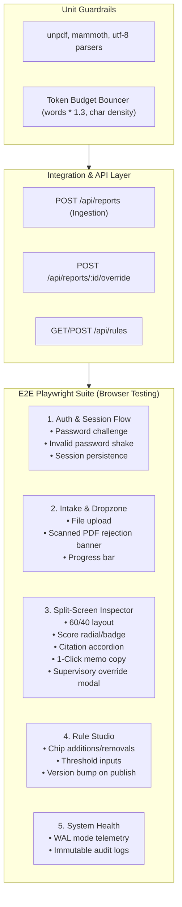

# Comprehensive Test Plan: RAGADV
## Automated Testing Strategy, Playwright E2E Test Matrix & Quality Gates
**Document Version:** 1.0.0  
**Classification:** Quality Assurance & Testing Engineering  
**Application Target:** Single-Operator Compliance Review & Self-Learning RAG Hub  
**Test Automation Framework:** Playwright (`@playwright/test`) + TypeScript  

---

## 1. Executive Summary & Quality Philosophy

The **RAGADV** quality assurance strategy combines fast deterministic unit parsers, server-side guardrails (Token Budget Bouncer), and real-browser automated end-to-end (E2E) testing via **Playwright**.

Because RAGADV is engineered as a zero-RBAC, high-efficiency Single-Operator Hub for lead compliance auditor Mary, automated tests focus on:
1. **Frictionless Operator Workflows:** Fast document drag-and-drop intake, live evaluation triage, and 1-click feedback generation.
2. **Deterministic Compliance Gates:** Rejection of non-compliant structural layouts and tripwire terms without false-negative leaks.
3. **Defense-in-Depth:** Rejection of corrupt or scanned PDFs, payload ceiling enforcement (32k tokens), and session protection.
4. **Supervisory Overrides & Auditability:** Verification that manual supervisory actions are stamped in SQLite audit trails.

---

## 2. Test Architecture & Pyramidal Hierarchy



---

## 3. End-to-End Test Matrix

| ID | Test Suite | Target Route | Preconditions | Input / Action | Expected Result | Priority |
| :---: | :--- | :--- | :--- | :--- | :--- | :---: |
| **TC-01** | Master Password Auth | `/login` | None | Enter invalid password (`wrongpass`) | Receives HTTP 401, error message rendered, form shakes, stays on `/login`. | P0 |
| **TC-02** | Master Password Auth | `/login` | Valid `ADMIN_PASSWORD` | Enter valid password (`admin123`) | Receives HTTP 200 + session cookie, automatically redirects to `/dashboard`. | P0 |
| **TC-03** | Route Protection | `/dashboard` | No session cookie | Direct navigation to `/dashboard` | Middleware intercepts and redirects to `/login`. | P0 |
| **TC-04** | Dashboard Layout | `/dashboard` | Authenticated | Navigate to `/dashboard` | Summary cards visible (Total Audited, Approved, Action Req, Rejections). | P1 |
| **TC-05** | Document Intake Dropzone | `/dashboard` | Authenticated | Drop compliant engineering report (`.txt`) | Progress bar progresses, file parsed and evaluated, returns score `100/100` [APPROVED]. | P0 |
| **TC-06** | Budget Bouncer Guardrail | `/dashboard` | Authenticated | Upload scanned/corrupt file (< 50 chars) | File rejected with `FILE_UNREADABLE_SCANNED` alert; does not reach LLM. | P1 |
| **TC-07** | Split-Screen Inspector | `/scorecards/[id]` | Evaluated report | Open `/scorecards/:id` | Left 60% displays document viewer/iframe; right 40% displays compliance breakdown. | P0 |
| **TC-08** | Verbatim Citations | `/scorecards/[id]` | Evaluated report | Click "Inspect cited evidence" | Citation text accordion expands displaying exact quote and page number. | P1 |
| **TC-09** | 1-Click Memo Copy | `/scorecards/[id]` | Evaluated report | Click "Copy Memo" | Pre-drafted text copied to clipboard, button switches to "Copied!" with check icon. | P1 |
| **TC-10** | Supervisory Override | `/scorecards/[id]` | Rejected report | Click "Supervisory Override", select "APPROVED", submit reason | Report status updates to APPROVED, audit log entry recorded. | P0 |
| **TC-11** | Scorecards Archive Hub | `/scorecards` | Evaluated reports | Navigate to `/scorecards` | Table lists all reports with page counts, status badges, scores, and Inspect buttons. | P1 |
| **TC-12** | Rule Studio Operations | `/rules` | Authenticated | Add mandatory section chip, add tripwire keyword, click "Publish" | Profile version increments to next integer, saved in SQLite. | P1 |
| **TC-13** | System Health Telemetry | `/settings` | Authenticated | Navigate to `/settings` | Storage engine displays "SQLite (WAL)", lifetime token metrics and audit log table rendered. | P2 |

---

## 4. Execution Protocols & CI Setup

### Running Test Suites Locally
```bash
# Run all Playwright tests in headless Chromium
npx playwright test

# Run tests in headed UI mode with interactive step inspector
npx playwright test --ui

# Run a specific spec file
npx playwright test tests/e2e/auth.spec.ts
```

### Success / Exit Criteria
- 100% of test cases in the test matrix pass without flakiness.
- All network assertions verify backend database state updates in SQLite.
- Zero accessibility or layout overflow regressions.
