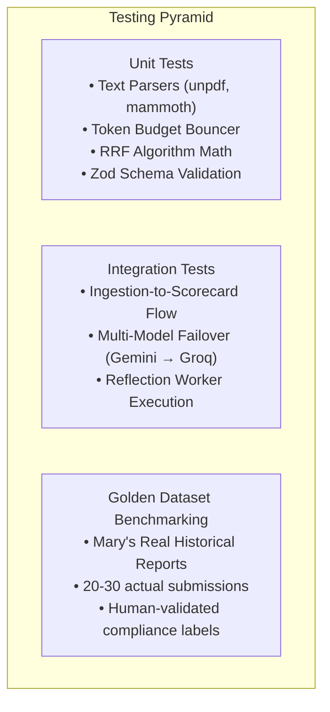

# Implementation Plan & Engineering Roadmap: RAGADV
## Delivery Schedule, Sprint Breakdown, Quality Assurance & Production Economics
**Document Version:** 3.6.0  
**Document Status:** Approved for Sprint Planning  
**Classification:** Internal Engineering Roadmap  
**Target Audience:** Engineering Leads, Scrum Masters, QA Engineers, Product Managers  

---

## 1. Executive Summary & Delivery Philosophy

This document outlines the end-to-end engineering execution plan for **RAGADV**—an automated document review and compliance auditing platform engineered with **Next.js (App Router)**, **Vercel AI SDK**, and a **Self-Learning Knowledge Reflection RAG Archive**.

### Core Engineering Principles
1. **Vertical Slice Delivery:** Each sprint delivers an end-to-end usable capability rather than disconnected horizontal tiers.
2. **Defensive API Economics:** Guardrails (Token Budget Bouncer, client-side pre-flight checks, caching) prevent unexpected cloud and LLM API cost overruns.
3. **Type Safety & Testability:** Compile-time Zod schemas guarantee zero runtime parsing regressions between LLM responses and the React dashboard.
4. **Phased Rollout:** Phase 1 delivers immediate operational ROI by automating Mary's routine review workload; Phase 2 introduces compounding organizational intelligence via Knowledge Reflection and Hybrid Archive Search.

---

## 2. Master Delivery Gantt Chart

```mermaid
gantt
    title RAGADV: 7-Sprint Phased Roadmap
    dateFormat  YYYY-MM-DD
    section Phase 1: Core Review Hub
    Sprint 1: Lightweight Auth & Hybrid Rule Builder :s1, 2026-10-01, 5d
    Sprint 2: Ingestion, Parsers & Token Bouncer    :s2, after s1, 7d
    Sprint 3: Evaluator & Single-Operator Dashboard  :s3, after s2, 7d
    Sprint 4: Observability & Pilot Validation      :s4, after s3, 7d
    section Phase 2: Self-Learning Archive RAG
    Sprint 5: Contextual Chunking & Hybrid Search   :s5, after s4, 7d
    Sprint 6: Knowledge Reflection Engine           :s6, after s5, 7d
    Sprint 7: 'Ask Archive' QA Interface & Launch   :s7, after s6, 7d
```

---

## 3. Sprint-by-Sprint Work Breakdown Structure (WBS)

### Sprint 1: Scaffolding, Lightweight Auth & Hybrid Rule Builder UI
- **Estimate:** 4–5 days (drastic reduction in auth/security overhead).
- **Objective:** Establish the application shell, lightweight single-person session authentication, lean database migrations, Docker infrastructure, and the no-code rule builder interface.
- **Tasks:**
  1. Initialize Next.js 15+ (App Router) project with TypeScript and ESLint.
  2. Configure Tailwind CSS 4.
  3. Initialize shadcn/ui: `npx shadcn@latest init`.
  4. Install base shadcn/ui components: `button`, `card`, `dialog`, `table`, `badge`, `popover`, `tabs`, `input`, `form`, `dropdown-menu`, `separator`.
  5. Implement Docker Compose setup with Dockerfile and `docker-compose.yml` for self-hosted VPS deployment. Services: `app` (Next.js), `db` (PostgreSQL + pgvector), `minio` (local S3-compatible storage).
  6. Run lean PostgreSQL DDL migrations for `departments` (including `default_rule_profile_id`), `rule_profiles`, `rule_profile_versions`, `reports` (including `parent_report_id`), and `audit_logs` (no `users` or `user_departments` tables).
  7. Setup `ADMIN_PASSWORD` validation in Next.js middleware and `POST /api/auth/login` with encrypted session cookie (`iron-session`), protecting routes and redirecting unauthenticated requests to `/login`.
  8. Build simple clean login page (`/login`) using shadcn/ui.
  9. Build Category / Department Switcher (`/workspace`) allowing the operator to toggle between departments/categories in the header.
  10. Develop the Hybrid Rule Builder (`/rules/new`):
     - Base template selection (*Weekly Progress*, *Field Log*, *Quality Audit*).
     - Mandatory section toggles with severity flags (`CRITICAL`, `WARNING`, `INFO`).
     - Numerical threshold inputs (e.g. *Budget variance > 10%*).
     - Red-flag keyword tag input (*litigation*, *unapproved*, *structural crack*).
     - "Add Custom Rule Card" for natural language guidelines.
  11. Add "Set as Default" button on rule profiles page.
- **Exit Criteria:** Operator logs in with `ADMIN_PASSWORD`; unauthenticated requests redirect to `/login`. Mary can create, preview, edit, and save a customized Rule Profile; profile is persisted to DB with complete JSON schema validation. Default rule profile can be set per department. Docker setup is complete, and application shell / rule builder UI is implemented with shadcn/ui + AI Elements component foundations on Tailwind CSS 4.

---

### Sprint 2: Ingestion Pipeline, Parsers & Token Budget Bouncer
- **Objective:** Implement reliable, in-memory document parsing, persistent storage, and pre-flight token guardrails.
- **Tasks:**
  1. Build Mary's Batch Upload Dropzone (`/batch`) supporting drag-and-drop for up to 25 files concurrently.
  2. Build single-document upload intake form (`/submit`): file picker + optional title + optional notes (utilizing `@ai-elements/attachments`).
  3. Configure file storage using `@aws-sdk/client-s3`. Uploaded files are stored in **Cloudflare R2** (production) / **MinIO** (local dev) and retained permanently.
  4. Implement server-side document text extractors:
     - `unpdf` stream extractor for digital text PDFs.
     - `mammoth` buffer parser for Microsoft Word (`.docx`) files.
     - UTF-8 text parser for `.txt` and `.md` files.
  5. Implement the **Token Budget Bouncer** (`lib/ai/budget.ts`):
     - Fast word-based token estimation (\(\text{words} \times 1.3\)).
     - Rejects any single document exceeding 32,000 estimated tokens with HTTP 413 (`PayloadTooLarge`).
     - Rejects corrupted or non-text scanned PDFs (< 50 selectable characters) with `FILE_UNREADABLE_SCANNED`.
  6. Add auto-evaluation pipeline trigger on upload (fetch default profile → Token Bouncer → evaluate → score → store scorecard).
- **Exit Criteria:** Dropping a 20-file mixed batch (PDF, DOCX, TXT) uploads to S3-compatible storage, parses in `< 2.5 seconds` with exact page count stamping and token budget validation. The operator can upload single or batch documents (using shadcn/ui + AI Elements attachments form), automatically evaluating against the active department's default rule profile.

---

### Sprint 3: Vercel AI SDK Evaluator & Unified Single-Operator Dashboard
- **Objective:** Wire the core LLM evaluation engine, sequential processing, and build Mary's unified Single-Operator Dashboard with interactive scorecards and reasoning inspection.
- **Tasks:**
  1. Configure Vercel AI SDK (`ai`) with the default enterprise provider (`@ai-sdk/google` using `gemini-3.8-flash`).
  2. Install and configure AI Elements components (added to `@/components/ai-elements/` and fully customizable):
     - Intake form: Install `npx shadcn@latest add @ai-elements/attachments`
     - Evaluation Queue: Install `npx shadcn@latest add @ai-elements/queue @ai-elements/task`
     - Scorecard Viewer: Install `npx shadcn@latest add @ai-elements/reasoning`
     - Ask Archive page: Install `npx shadcn@latest add @ai-elements/conversation @ai-elements/message @ai-elements/prompt-input @ai-elements/inline-citation @ai-elements/sources @ai-elements/shimmer`
     - Note: Components are added to `@/components/ai-elements/` and are fully customizable.
  3. Implement sequential document processing with an SSE streaming endpoint for real-time batch progress (Evaluation Queue utilizing `@ai-elements/queue` and `@ai-elements/task`).
  4. Implement `generateObject` in `/api/evaluate` constrained by `documentScorecardSchema` (Zod). The LLM returns per-rule verdicts; the server computes the overall score applying the penalty formula.
  5. Build the **Interactive Scorecard Viewer** (`/scorecard/[id]`) using shadcn/ui and `@ai-elements/reasoning`:
     - Overall Compliance Score radial gauge (0–100).
     - Status badges: `APPROVED` (Green), `ACTION_REQUIRED` (Amber), `REJECTED` (Red).
     - Rule check cards displaying rule title, status, reasoning inspection, and remediation advice.
     - Clickable verbatim citations highlighting excerpted text and page numbers.
     - **1-Click Feedback Memo Generator**: Pre-populates a polite, professional message to the author detailing required revisions.
     - **Action Buttons**: `Approve Report` (queues for Phase 2), `Request Revision` (copies feedback), and `Supervisory Override`.
     - Version chain view on scorecard page (show original + resubmission side by side).
  6. Build the **Unified Single-Operator Dashboard** (`/dashboard`) using shadcn/ui:
     - **Intake Form**: Single and bulk upload dropzone powered by `@ai-elements/attachments`.
     - **Evaluation Queue**: Active processing and pending queue powered by `@ai-elements/queue` and `@ai-elements/task` with real-time SSE progress.
     - **Scorecard Viewer / Hub**: Filterable list of all evaluated reports with summary metrics (pending count, weekly processed, avg score, approval ratio) and reasoning inspection via `@ai-elements/reasoning`.
     - **Category / Department Switcher**: Toggle to filter reports, rules, and evaluations by department/category.
     - *Note: Multi-user management screens, RBAC route guards, and inter-user notification feeds have been removed in favor of the single-operator workflow.*
  7. Add batch error handling: per-document error with Retry button, batch continues on failure.
- **Exit Criteria:** Submitting single or bulk files streams sequential progress via SSE in the Evaluation Queue; batch processing continues on individual file failures with retry options; Mary can inspect AI reasoning and verbatim citations, override false positives, and copy feedback memos in one click; unified Single-Operator Dashboard seamlessly integrates intake, queue, metrics, and scorecard viewer with category/department switching; all UI components are built using shadcn/ui + AI Elements without user management or RBAC overhead.

---

### Sprint 4: Observability, Latency Optimization & Pilot Validation
- **Objective:** Instrument MLOps tracking, optimize latency, establish report lifecycle policies, and conduct a live pilot with lead reviewer Mary.
- **Tasks:**
  1. Implement observability logging committing to `scorecards`:
     - Exact `input_tokens`, `output_tokens`, and inference cost in USD.
     - Latency breakdown per stage (parsing ms, LLM inference ms, DB save ms).
  2. Implement exponential backoff retry logic for model rate limits (HTTP 429).
  3. Implement report lifecycle policies:
     - **Approved reports:** permanent storage + RAG archive.
     - **Failed/Rejected reports:** soft-deleted, purged after 30 days, never enter RAG.
  4. Conduct Pilot Validation using **Mary's real historical reports** (20-30 actual team submissions from the past 2 months). Mary manually validates scorecards against her own judgment.
     - Measure precision and recall of compliance flags against her judgment.
     - Eliminate false-positive triggers on standard formatting quirks.
  5. Add Operator audit log viewer (`/admin/audit-log`) with filters (action type, department/category, date range).
  6. Add 24-hour sliding session expiry configuration for `iron-session`.
- **Exit Criteria:** 95% agreement between automated scorecards and Mary's manual validation (primary acceptance criterion); average evaluation latency under **4.5 seconds** per report; report lifecycle rules enforce proper retention and purging; Operator audit log viewer provides full visibility into system actions; 24-hour sliding session security is enforced.

---

### Sprint 5: Phase 2 — Contextual Chunking & Hybrid Search (pg_trgm + Vectors)
- **Objective:** Overhaul storage for Phase 2, implementing hybrid search with Reciprocal Rank Fusion.
- **Tasks:**
  1. Implement **Contextual Retrieval Chunking**: Prepend document metadata and section breadcrumbs (`[Document: X | Date: Y | Section: Z]`) to every chunk before embedding. Ensure archive chunks include `department_id` metadata. Lock chunking parameters: 800-token chunks, 200-token overlap, contextual headers.
  2. Configure PostgreSQL `tsvector` + `pg_trgm` for sparse retrieval. Add GIN index creation to database tasks.
  3. Configure vector indexing (`pgvector`) locking the model to `gemini-embedding-001` (768 dimensions). Note: changing models later requires full re-embedding.
  4. Implement the **Reciprocal Rank Fusion (RRF)** algorithm (\(k=60\)) merging sparse and dense search results. Ensure vector search and FTS queries are filtered by `department_id`. Lock Top-K = 5 retrieval with RRF fusion.
- **Exit Criteria:** System demonstrates 100% retrieval precision on queries with exact alphanumeric project codes (`PRJ-9042`) and acronyms where pure vector search fails, with results strictly scoped to the active department/category, locked to Top-K = 5 retrieval with RRF fusion.

---

### Sprint 6: Phase 2 — Knowledge Reflection & Consolidation Engine
- **Objective:** Implement the self-learning memory layer that synthesizes cross-report connections on approval.
- **Tasks:**
  1. Hook the `Approve` button to trigger an asynchronous background worker (`reflectOnApproval`). RAG ingestion triggers automatically on report approval (not manually). Confirm Knowledge Reflection Engine is in-scope (not deferred).
  2. Implement the 3-Sentence Reflection Engine:
     - Vector searches 3 most related historical reports (similarity > 0.65).
     - Prompts Gemini 3.8 Flash to synthesize: 1. Novel additions, 2. Cross-report connections, 3. Open risks/gaps.
     - Indexes reflection artifacts with `doc_type = 'reflection'` and a **1.5× search boost**.
  3. Implement the Consolidation Worker:
     - Checks if unconsolidated reflections \(\ge 3\) (CONSOLIDATION_THRESHOLD = 3).
     - Consolidates reflections into a higher-level summary (`doc_type = 'summary'`, **1.8× search boost**).
- **Exit Criteria:** Approving report #4 on a project automatically triggers RAG ingestion and produces a high-level reflection connecting it to reports #1–#3 without blocking the UI, correctly applying reflection and summary search boosts based on a threshold of 3.

---

### Sprint 7: Phase 2 — "Ask Archive" QA Interface, Product Naming & Launch
- **Objective:** Build the conversational search interface, name the product, and prepare for production launch.
- **Tasks:**
  1. Choose the product name and build a simple public landing page.
  2. Build the "Ask Archive" interface (`/archive`) with natural language search bar, date range + keyword filter bar. Operator accesses "Ask Archive" scoped to the active department/category.
  3. Implement grounded streaming answers with clickable source badges citing exact archived reports and page numbers. Include Ask Archive UI using AI Elements (`@ai-elements/conversation`, `@ai-elements/message`, `@ai-elements/prompt-input`, `@ai-elements/inline-citation`, `@ai-elements/sources`, `@ai-elements/shimmer`): chat-style Q&A with streamed responses and inline citations, stateless single-turn query flow (no conversation memory), and Sources section rendering below streamed answer.
  4. Surface 💡 Knowledge Reflection cards in search results, distinguishing synthesized insights from raw document paragraphs.
  5. Extend Token Budget Bouncer for RAG queries (500K tokens/day default, operator-configurable).
  6. Add backup cron job to Docker Compose stack (daily `pg_dump` to R2).
  7. Document restore procedure in README.
  8. Perform end-to-end security penetration test and finalize production documentation.
- **Exit Criteria:** The product has a finalized name and landing page; Mary can ask cross-report stateless single-turn questions spanning six months of data and receive accurate, grounded streaming syntheses with inline citations scoped to her active department/category using shadcn/ui + AI Elements; RAG query budget limits and DB backups are fully operational.

---

## 4. Quality Assurance & Testing Strategy



### 4.1 Automated Test Execution Protocols
- **Parser Unit Tests:** Verify character density, heading extraction, and table preservation across 10 sample PDF and DOCX formats.
- **Token Bouncer Tests:** Verify that synthetic files of 35,000 tokens are rejected before any network call occurs.
- **Golden Dataset Regression Suite:** A curated suite of 20-30 historical reports with Mary's own manual human-verified compliance scores from the past 2 months. Executed automatically before any prompt or model update to ensure compliance scoring does not drift by \(> \pm 3\%\) from her judgment.

---

## 5. Risk Register & Mitigation Strategy

| Risk ID | Description | Impact | Probability | Mitigation Strategy |
| :---: | :--- | :---: | :---: | :--- |
| **R-01** | LLM Hallucination of Violations | High | Low | Zod schema requires verbatim `evidenceQuote` and `pageNumber`. If quote does not exist in text, flag is discarded. |
| **R-02** | Unexpected Cloud Cost Spikes | High | Medium | Strict Token Budget Bouncer rejects files > 32,000 tokens. Batch pricing discounts utilized for bulk jobs. |
| **R-03** | Submitter Backlash to Automated Review | Medium | Medium | Human-in-the-loop requirement: system never messages submitters directly. Mary reviews and sends all feedback. |
| **R-04** | Scanned / Image-Only PDF Uploads | Low | High | Pre-flight parser inspects character density; rejects scanned documents immediately with clean user advice. |
| **R-05** | Model Vendor Downtime / Outage | Medium | Low | Vercel AI SDK multi-provider architecture allows instant failover from Gemini to DeepSeek or Groq via `.env`. |

---

## 6. Production Operating Economics & Sensitivity Analysis

By utilizing the Vercel AI SDK and Google Gemini 3.8 Flash, operational costs remain orders of magnitude lower than commercial SaaS wrappers:

| Metric | Low Volume (50 Reports/mo) | Baseline Volume (200 Reports/mo) | High Volume (1,000 Reports/mo) |
| :--- | :---: | :---: | :---: |
| **Average Report Size** | 8 Pages (3,200 tokens) | 8 Pages (3,200 tokens) | 8 Pages (3,200 tokens) |
| **Document Ingestion (Gemini 3.8 Flash)** | \$0.02 | \$0.10 | \$0.48 |
| **Scorecard Output Generation** | \$0.02 | \$0.10 | \$0.48 |
| **Reflection Engine Invocations** | \$0.01 | \$0.02 | \$0.11 |
| **Vector Embeddings (Phase 2)** | \$0.002 | \$0.01 | \$0.05 |
| **Cloud Hosting (Self-hosted VPS via Docker)** | \$10.00 (Starter) | \$15.00 (Standard) | \$20.00 (Pro) |
| **Total Monthly Operating Cost** | **~\$10.05 / month** | **~\$15.23 / month** | **~\$21.12 / month** |

> [!NOTE]
> Even at 1,000 multi-page reports per month, the total AI compute cost remains under **\$1.20**, making the Hetzner/DigitalOcean VPS hosting the primary fixed operational expenditure.
